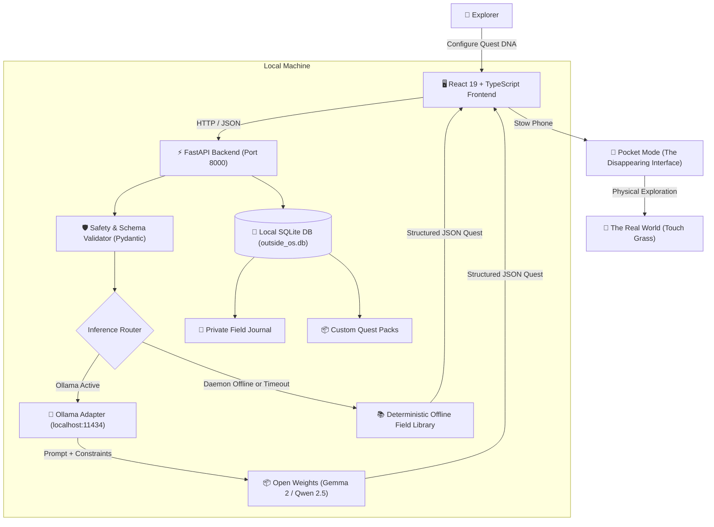

# OUTSIDE//OS 🌿

> **"Your AI should get you out of the app, not keep you inside it."**

[](https://hacktoberfest.com/)
[](LICENSE)
[]()
[]()
[]()

**OUTSIDE//OS** is a local-first, open-source AI-powered real-world adventure engine. It transforms an explorer's available time, surroundings, energy level, and physical accessibility needs into actionable outdoor quests.

It is **not** a generic chatbot, habit tracker, maps clone, or gamified to-do list.

### Its Central Product Principle:
**Generate a quest. Leave the screen. Experience the world. Return only to record what you discovered.**

---

## 🧭 The Five Signature Differentiators

### 1. The Disappearing Interface — Primary Innovation
Most AI apps try to maximize your screen time. OUTSIDE//OS intentionally minimizes it:
- Generates a structured 3–5 step expedition.
- Transitions into a clean **Expedition Screen** with only mission objectives and a timer.
- Offers **Pocket Mode**: A deep black screen with the clear instruction: *"Put your phone in your pocket. Eyes on the horizon."*
- Real elapsed time is calculated using timestamp differences—locking the phone or dimming the screen will never lose your session.

### 2. Quest DNA — Personalized Generation
- **Time Flexibility:** 10, 15, 30, 45, or 60 minutes.
- **Energy Levels:** Low (sensory observation), Balanced (gentle wander), High (dynamic perimeter search).
- **Physical Accessibility:** Dedicated input for wheelchair accessibility, step-free requirements, and seated window observations.
- **Strict Environmental Constraints:** Works on any balcony, garden, street sidewalk, or campus. Never hallucinates local park opening hours, trails, or species.

### 3. Reality Mode — Designed for the Physical World
- Observe leaf vein architecture without plucking leaves.
- Identify sidewalk lichen colonies without scraping them.
- Map subtle changes between direct sunlight and tree canopy shade.
- Zero equipment required by default (`No Equipment` filter).

### 4. Open Nature Memory — Private, Local-First Journal
- Persisted locally inside your machine's SQLite database (`backend/data/outside_os.db`).
- Records self-reported outdoor minutes, notes, optional photo attachments, and checklist accomplishments.
- Complete data sovereignty: **Export Full JSON**, **Export Markdown Field Note**, or **Wipe All Local Data** with one click.

### 5. Open Quest Packs — Community Extension System
- Extensible via JSON packs validated against strict Pydantic schemas.
- Includes 3 built-in starter packs:
  1. *Urban Nature Explorer* (Sidewalk crevices, lichens, masonry flora)
  2. *Slow Walks and Mindful Observation* (Acoustic soundscapes, thermal micro-climates)
  3. *Small-Space Gardening* (Balcony container moisture, seed pods, leaf nodes)
- Live in-app JSON schema validator for contributors.

---

## 🏛️ System Architecture



---

## 🤖 Open-Source AI Model Architecture

OUTSIDE//OS is designed for **100% local inference**. It does not require OpenAI, Anthropic, or any cloud API keys.

| Model Tag | Parameters | License | RAM / VRAM | Pull Command |
| :--- | :--- | :--- | :--- | :--- |
| **`gemma2:2b`** *(Recommended)* | 2.6 Billion | Google Gemma Open License | ~2.6 GB | `ollama run gemma2:2b` |
| **`qwen2.5:1.5b`** | 1.5 Billion | Apache 2.0 | ~1.8 GB | `ollama run qwen2.5:1.5b` |
| **`qwen2.5:3b`** | 3.1 Billion | Apache 2.0 | ~3.4 GB | `ollama run qwen2.5:3b` |

### Why Open-Weight Local Inference Matters:
1. **Zero Privacy Leaks:** Your neighborhood descriptions, daily walking hours, and personal reflections never leave your machine.
2. **Offline Resilient:** If you take your laptop to a cabin or run OUTSIDE//OS without internet access, the deterministic offline library guarantees 100% functionality.
3. **No Hidden Costs:** Completely free to run with zero cloud token billing.

---

## 🔒 Privacy & Offline Capability Matrix

| Capability | Online Cloud | Local Ollama | Offline (No Internet, No Model) |
| :--- | :---: | :---: | :---: |
| App Shell & UI Navigation | N/A | ✅ Yes | ✅ Yes |
| Adventure Builder Configuration | N/A | ✅ Yes | ✅ Yes |
| Quest Generation via Open AI Model | N/A | ✅ Yes | ❌ (Falls back to offline library) |
| Deterministic Quest Generation | N/A | ✅ Yes | ✅ Yes (18+ verified archetypes) |
| Expedition Mode & Pocket Mode | N/A | ✅ Yes | ✅ Yes |
| Timestamp-Based Elapsed Timer | N/A | ✅ Yes | ✅ Yes |
| Field Journal SQLite Persistence | N/A | ✅ Yes | ✅ Yes |
| Community Quest Packs & Validator | N/A | ✅ Yes | ✅ Yes |
| Full JSON & Markdown Export | N/A | ✅ Yes | ✅ Yes |

---

## 🚀 Quickstart Guide

### Prerequisites
- Python 3.10+
- Node.js 18+ and npm
- *(Optional, for live local AI generation)* [Ollama](https://ollama.com/)

### 1. Clone & Set Up Backend

```bash
# Clone the repository
git clone https://github.com/your-username/outside-os.git
cd outside-os

# Create and activate Python virtual environment
python -m venv venv

# Windows PowerShell:
.\venv\Scripts\Activate.ps1
# macOS/Linux:
source venv/bin/activate

# Install dependencies
pip install -r backend/requirements.txt
```

### 2. Start the Backend Server

```bash
# Windows PowerShell:
$env:PYTHONPATH="backend"
python -m uvicorn app.main:app --host 127.0.0.1 --port 8000

# macOS / Linux:
PYTHONPATH=backend python -m uvicorn app.main:app --host 127.0.0.1 --port 8000
```
Backend will be live at `http://127.0.0.1:8000`.

### 3. Set Up & Start the Frontend

In a new terminal window:
```bash
cd frontend
npm install
npm run dev
```
Open `http://127.0.0.1:5173` in your browser.

### 4. Enable Local AI Generation (Optional)
If you have Ollama installed:
```bash
ollama run gemma2:2b
```
The app will automatically detect Ollama and switch from the Offline Library to `ollama:gemma2:2b`!

---

## 🧪 Automated Testing Suite

OUTSIDE//OS includes comprehensive test coverage for all 14 mandatory test cases:

```bash
$env:PYTHONPATH="backend"
pytest -v backend/tests
```

### Test Scenarios Covered:
1. `test_valid_adventure_configuration` — Validates Quest DNA parameters.
2. `test_invalid_adventure_configuration` — Rejects out-of-spec parameters (HTTP 422).
3. `test_valid_generated_quest_schema` — Ensures strict Pydantic compliance.
4. `test_malformed_model_response_fallback` — Bounded retry and graceful fallback on malformed JSON.
5. `test_model_server_unavailable` — Automatic fallback when Ollama is offline.
6. `test_explicit_offline_fallback` — User-selected offline library mode.
7. `test_quest_checklist_tracking` — Progress recording and partial completion states.
8. `test_pause_and_resume_timing_calculation` — Accurate elapsed time across screen pauses.
9. `test_journal_persistence_and_retrieval` — SQLite field notebook roundtrip.
10. `test_export_and_deletion` — Full JSON export and user data wipe.
11. `test_quest_pack_validation` — JSON schema validator for community packs.
12. `test_empty_journal_and_search` — Graceful empty states and search filters.
13. `test_accessibility_adaptation` — Automatically adapts instructions for seated/step-free needs.
14. `test_unsafe_mission_rejection` — Rejects hazardous or trespassing requests.

---

## 🎬 60–90 Second Demonstration Script

| Time | Screen | Action & Voiceover |
| :--- | :--- | :--- |
| **0:00–0:15** | Landing Page | *"This is OUTSIDE//OS. Built for Hacktoberfest's Touch Grass theme with one guiding principle: Your AI should get you out of the app, not keep you inside it."* Point out the live local model indicator badge. |
| **0:15–0:30** | Adventure Builder | Click *Create an Adventure*. Configure 15 minutes, balanced energy, neighborhood, and nature observation. Click *Generate Outdoor Quest*. |
| **0:30–0:45** | Generated Quest | *"Notice the field card. The local model generated concrete steps: find 3 leaf vascular patterns without plucking foliage, complete with safe alternatives and safety notes. It clearly displays its provenance badge."* Click *Accept Quest*. |
| **0:45–1:05** | Expedition & Pocket Mode | *"Here is the primary innovation: The Disappearing Interface."* Click *Pocket Mode*. *"The screen dims to an ambient black OLED display telling the user: Put your phone in your pocket. The timer tracks outdoor time using timestamp diffs in the background."* |
| **1:05–1:20** | Return & Reflect | Tap screen to awaken controls. Click *I Have Returned*. Check observed items, type a quick observation: *"Found oak leaf with deep lobed veins"*, and click *Save to Field Journal*. |
| **1:20–1:30** | Journal & Settings | Show the saved entry in the Field Notebook. Click *Export Markdown*. Show the *Packs & Settings* page with community packs and local model controls. |

---

## 🗺️ Project Roadmap

- [x] **P0:** Responsive Landing Page with botanical topographic aesthetic.
- [x] **P0:** Adventure Builder with time, energy, environment, and accessibility selectors.
- [x] **P0:** Local Ollama adapter with bounded retries and JSON format enforcement.
- [x] **P0:** Deterministic fallback generator with 18+ verified archetypes.
- [x] **P0:** Expedition Mode with timestamp-based timer and Pocket Mode.
- [x] **P0:** Local SQLite persistence with search, tags, and stats calculation.
- [x] **P0:** 14 automated backend unit tests passing.
- [x] **P1:** Community Quest Pack JSON Schema Validator and 3 Starter Packs.
- [x] **P1:** Field Journal export to JSON and Markdown format.
- [x] **P1:** Full user privacy controls (complete data wipe and audit).
- [x] **P2:** Periodic gentle audio chime intervals for Pocket Mode (Web Audio API synthetic singing bowl).
- [ ] **P2 (Planned):** Multilingual community quest pack localizations.
- [ ] **P2 (Planned):** Web Audio binaural nature soundscape synthesizer for seated reflections.

---

## 🤝 Hacktoberfest Community & Contributing

We actively welcome open-source contributions! See [`CONTRIBUTING.md`](CONTRIBUTING.md) for:
- How to author and submit a Community Quest Pack.
- 5 well-scoped good-first-issues for beginners.
- Code standards and testing guidelines.

---

## 📄 License

Licensed under the **Apache License, Version 2.0**. See [`LICENSE`](LICENSE) for details.
All quest templates and field cards are distributed under open community terms.
